<p align="center">
  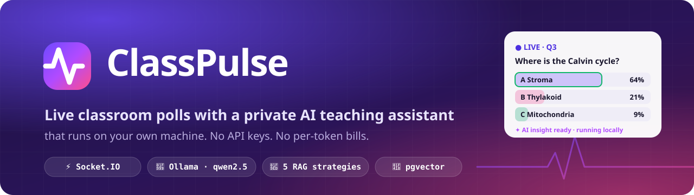
</p>

<p align="center">
  <a href="LICENSE"></a>
  
  
  
  
  
  
</p>

<p align="center">
  <a href="#-wheres-the-code"><b>Where's the code?</b></a> ·
  <a href="#-quick-start"><b>Quick start</b></a> ·
  <a href="#-features"><b>Features</b></a> ·
  <a href="#-how-it-works"><b>Architecture</b></a> ·
  <a href="#-the-rag-engine"><b>RAG benchmark</b></a> ·
  <a href="#-engineering-notes"><b>Engineering notes</b></a> ·
  <a href="#-contributing"><b>Contributing</b></a>
</p>

---

**ClassPulse** is an open-source, real-time classroom polling app with an AI teaching assistant that runs
**entirely on your own hardware**. Students join from any phone with a code. The teacher asks questions and
watches answers arrive live. Local language models write quizzes from the teacher's own notes, explain *why*
the class got a question wrong, and answer student questions with citations to the course material.

> **No API keys. No per-token bills. Student data never leaves your server.**
> Everything below runs on a 2023 laptop CPU with no GPU.

<p align="center">
  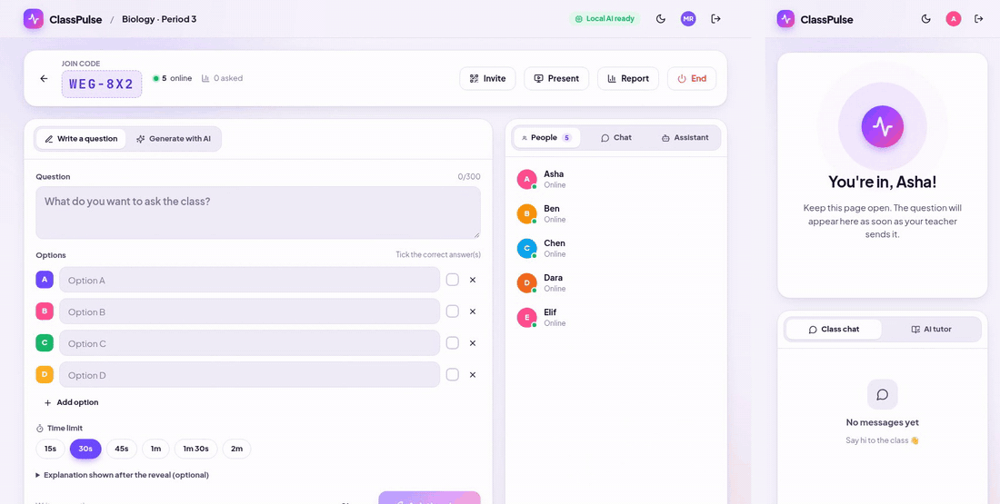
  <br><sub>Recorded from the real app by a Playwright script (<code>e2e/demo.spec.ts</code>): the teacher's console on the left, a student's phone on the right.</sub>
</p>

## 🗺 Where's the code?

| Folder | What's inside | Start reading at |
|---|---|---|
| [`apps/web`](apps/web/src) | 🖥 **The website**: teacher console, student phone view, projector, reports (React) | [`pages/`](apps/web/src/pages) |
| [`apps/server`](apps/server/src) | ⚙️ **The backend**: REST API, live Socket.IO events, poll timers, auth | [`realtime/io.ts`](apps/server/src/realtime/io.ts) |
| [`packages/rag-core`](packages/rag-core/src) | 🧠 **The AI / RAG engine**: chunking, 5 retrieval strategies, quiz, tutor | [`retrieve.ts`](packages/rag-core/src/retrieve.ts) |
| [`apps/ai-worker`](apps/ai-worker/src) | 🤖 Runs AI jobs in the background and streams answers back | [`index.ts`](apps/ai-worker/src/index.ts) |
| [`packages/shared`](packages/shared/src) | 🔗 Types and validation shared by the website and the backend | [`events.ts`](packages/shared/src/events.ts) |
| [`packages/evals`](packages/evals) | 📊 The RAG benchmark and sample course material | [`run.ts`](packages/evals/src/run.ts) |
| [`e2e`](e2e) | 🧪 Browser tests with a real teacher and students | [`polling.spec.ts`](e2e/polling.spec.ts) |

The files at the top level are only project settings (TypeScript, linting, Docker, npm workspaces).

## ✨ Why ClassPulse?

| | |
|---|---|
| 🔒 **Private by design** | Models run through [Ollama](https://ollama.com) on your machine. Nothing a student types is sent to a third-party AI service. |
| 📚 **Grounded, not guessed** | Quizzes and tutor answers come from *your* uploaded material via retrieval-augmented generation (RAG), with citations down to the section. |
| 🏫 **Built for real classrooms** | Survives refreshed tabs, flaky school Wi-Fi, server restarts, and 30 students sharing one IP address. |
| 🧪 **Measured, not hand-waved** | Five retrieval strategies with a reproducible benchmark, real-browser end-to-end tests, and CI. |
| 💸 **$0 per student** | Free models, free software, MIT licensed. Run it for one class or a whole school. |

## 🎯 Features

<table>
<tr>
<td width="50%" valign="top">

### 📡 Live polling
- Join with a 6-character code or **QR code**, no student accounts
- Countdown ring, live answer progress, **auto-reveal** when everyone has answered
- Correct answers are **never sent to students** until the poll ends
- Timers live in Redis, so polls end on time **even after a server restart**
- Refresh mid-question and you're back with your answer locked in
- Keyboard shortcuts (1–6), confetti, score and streak for students
- Class chat, removing a student, ending a session
- **Projector mode** with a giant join code and animated results
- **Reports**: accuracy per question, scores per student, **CSV export**

</td>
<td width="50%" valign="top">

### 🧠 Local AI
- **Quiz generator**: upload a PDF or notes and get multiple-choice questions with difficulty, Bloom level, explanation and **citations**. They stream in one at a time.
- **Misconception insights**: after every poll, AI explains the most popular wrong answer and drafts a **one-click follow-up question**
- **Student tutor**: answers *only* from course material, streams word by word, cites sources, and **pauses itself during live questions** so it can't be used to look up answers
- **Teaching assistant**: "Who needs help?" "What should I reteach?", answered from the real class data
- **Concept map**: an interactive knowledge graph of every document
- Usage dashboard (calls and latency) and per-teacher daily limits

</td>
</tr>
</table>

## 📸 Screenshots

| AI quiz generator with citations | Misconception insight + follow-up |
|---|---|
| 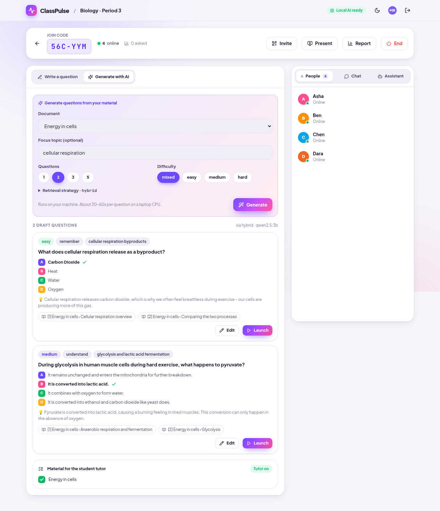 | 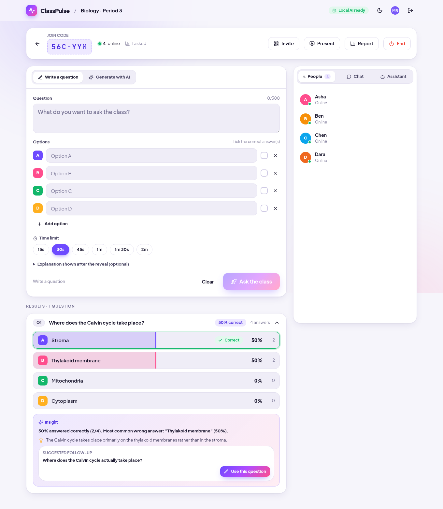 |

| Student question | Correct! | Tutor with sources |
|---|---|---|
| 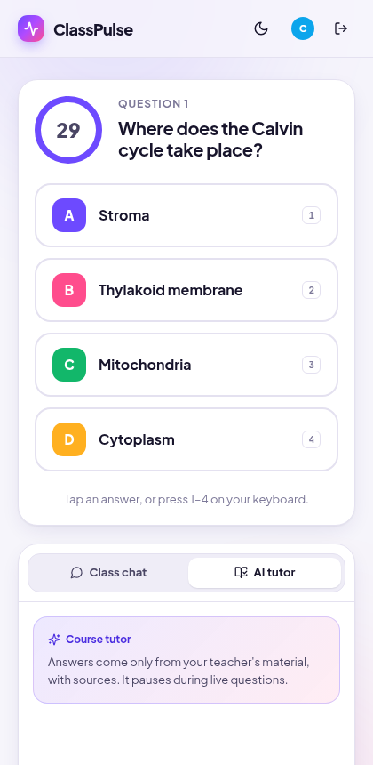 | 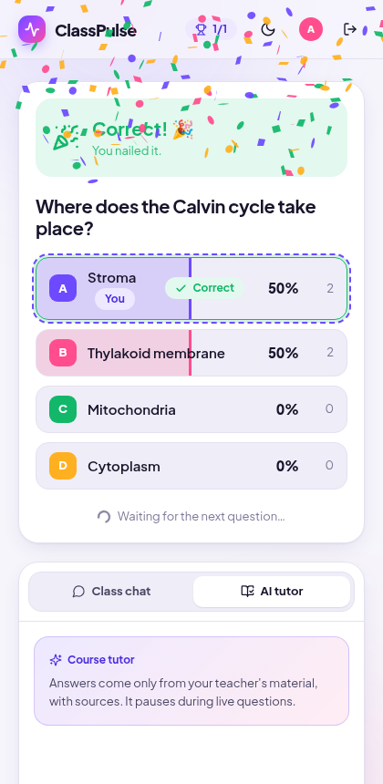 | 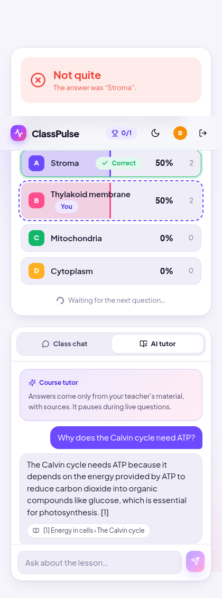 |

| Projector mode | Concept map (GraphRAG) |
|---|---|
| 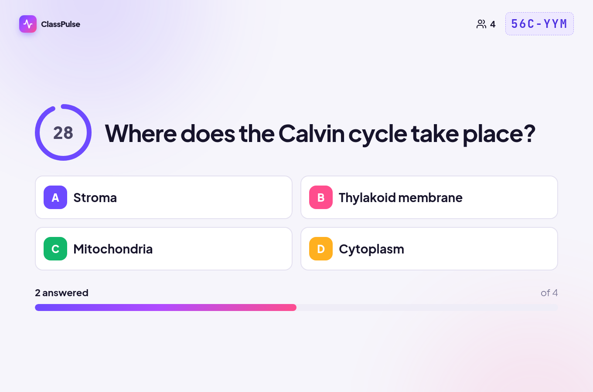 | 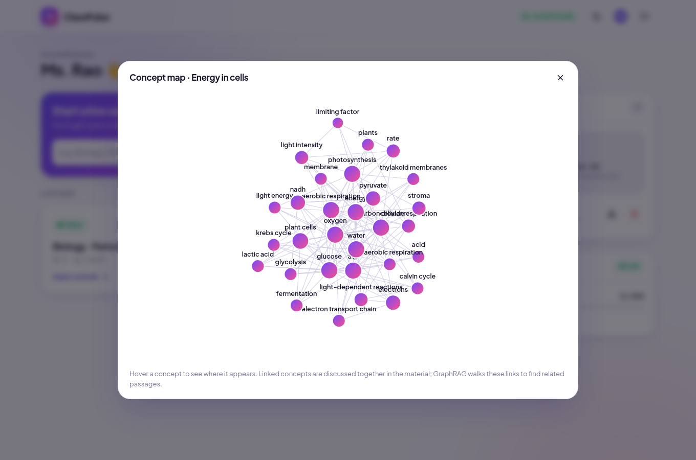 |

| Session report | Dark mode |
|---|---|
| 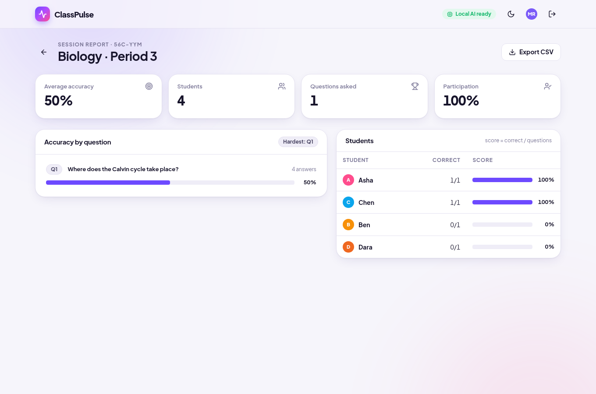 | 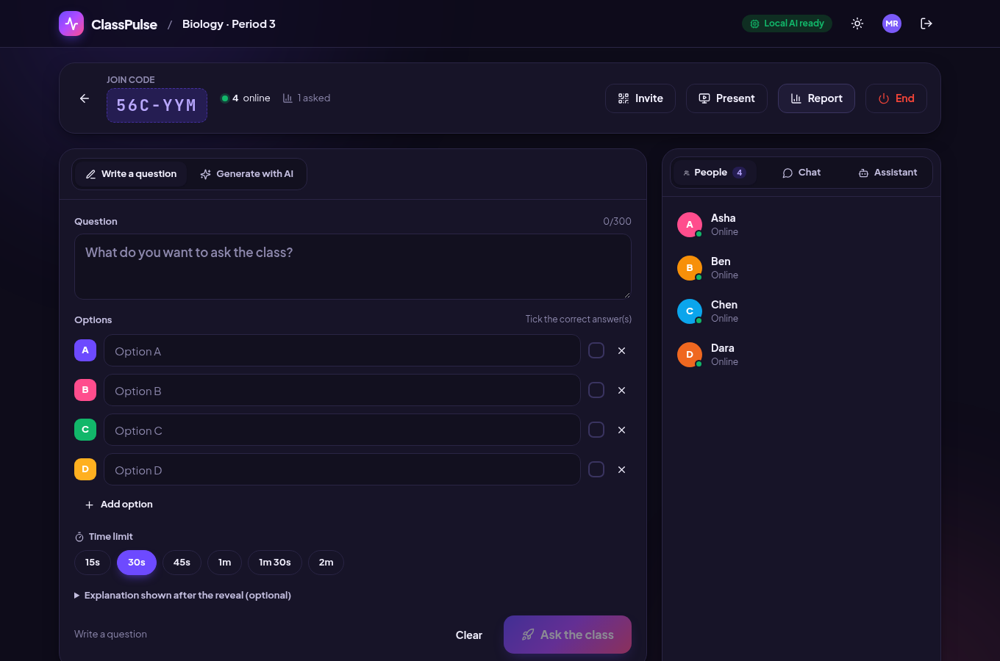 |

<details>
<summary><b>More screenshots</b></summary>

| Landing page | Teacher dashboard |
|---|---|
| 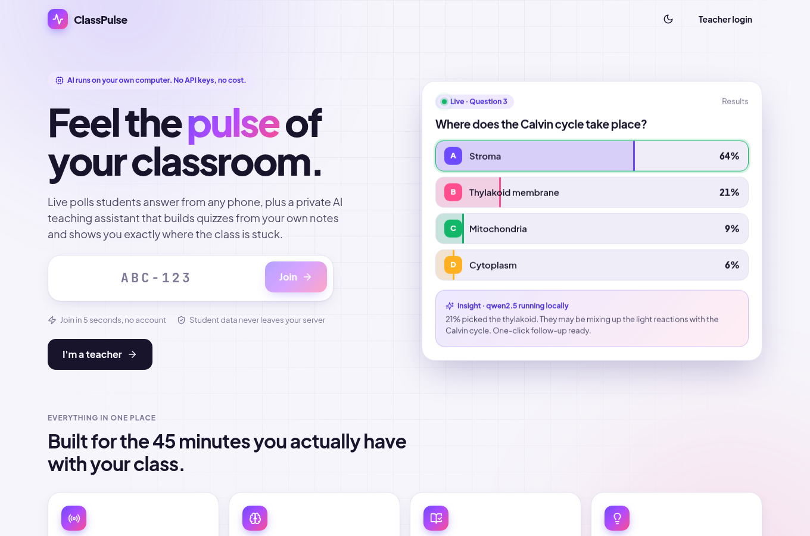 | 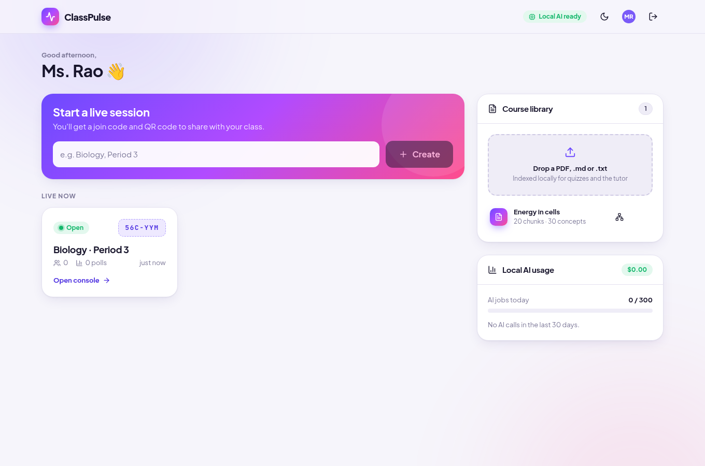 |

| Projector results |
|---|
| 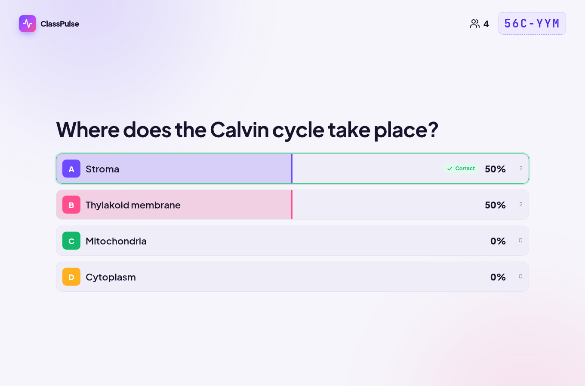 |

</details>

## 🚀 Quick start

**Requirements:** Node 20+, Docker, and [Ollama](https://ollama.com/download).

```bash
git clone https://github.com/PMaheshwarreddy/Live-Polling-System.git classpulse && cd classpulse

# 1. Pull the local models (~3 GB, one time)
ollama pull qwen2.5:3b && ollama pull qwen2.5:1.5b && ollama pull all-minilm

# 2. Start Postgres (pgvector) and Redis
docker compose up -d postgres redis

# 3. Configure and run
cp .env.example .env        # set JWT_SECRET to a long random string
npm install
npm run dev                 # API :5000 · AI worker · web :5173
```

Then open **http://localhost:5173**:
1. Create a teacher account and upload [`packages/evals/data/energy-in-cells.md`](packages/evals/data/energy-in-cells.md) in the dashboard.
2. Start a session and open the join link on your phone, or in a private window.
3. Ask a question, or switch to **Generate with AI**.

<details>
<summary>No Docker Compose? Use plain <code>docker run</code></summary>

```bash
docker run -d --name classpulse-pg -e POSTGRES_USER=classpulse -e POSTGRES_PASSWORD=classpulse \
  -e POSTGRES_DB=classpulse -p 5432:5432 pgvector/pgvector:pg16
docker run -d --name classpulse-redis -p 6379:6379 redis:7-alpine
```
</details>

<details>
<summary>Just want polling, no AI?</summary>

Set `AI_ENABLED=false` in `.env`. Ollama isn't needed; the AI features hide themselves from the UI.
</details>

## 🏗 How it works

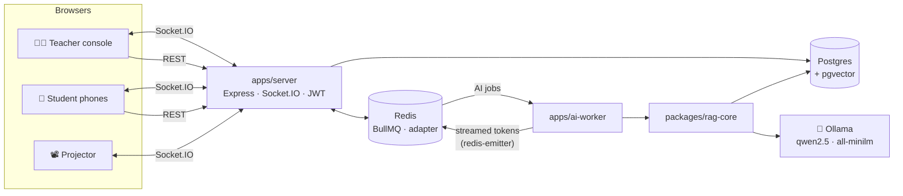

The API never waits on a model. Anything model-backed becomes a **BullMQ job**. The worker streams tokens
and progress back through Redis to exactly the right Socket.IO room: the tutor's answer goes to one
student, a quiz to one teacher. Student tutor jobs **take priority** over long quiz jobs, so a student
never waits behind a five-question quiz.

<details>
<summary><b>The life of a poll</b> (sequence diagram)</summary>

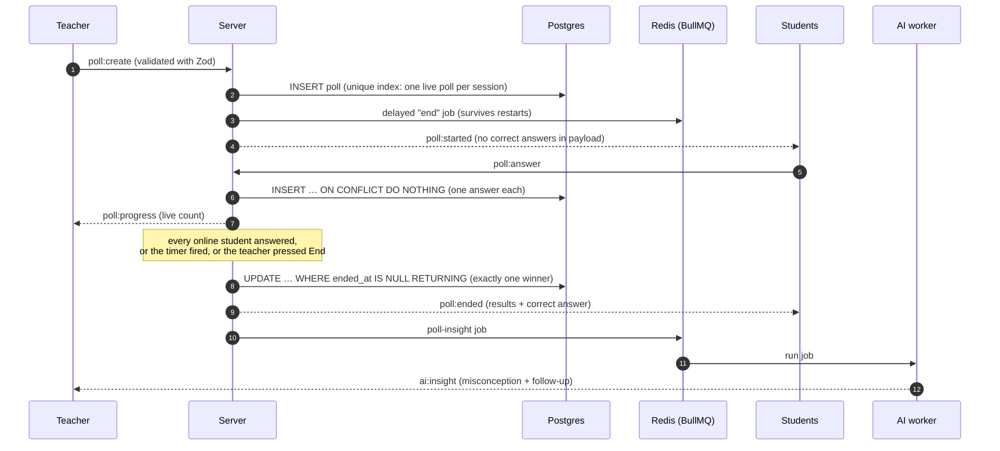
</details>

### Tech stack

| Layer | Choices |
|---|---|
| **Web** | React 19, Vite, TypeScript, React Router, Socket.IO client, a hand-built CSS design system (light/dark, no UI framework), lucide icons |
| **API** | Node 20, Express 5, Socket.IO 4 with the Redis adapter (scales to several instances), Zod, JWT, Helmet, rate limiting, pino |
| **Data** | PostgreSQL 16 + **pgvector** (HNSW) + full-text search, Redis 7 + **BullMQ** |
| **AI** | **Ollama**: `qwen2.5:3b` (quizzes, assistant), `qwen2.5:1.5b` (tutor, insights, HyDE, CRAG), `all-minilm` (embeddings); swap in any Ollama model |
| **Quality** | Vitest, **Playwright** (real multi-browser classrooms), ESLint, GitHub Actions |

## 🧭 The RAG engine

`packages/rag-core` is a small, readable, dependency-light RAG library. It has no LangChain, just about
1,200 lines of TypeScript you can follow end to end.

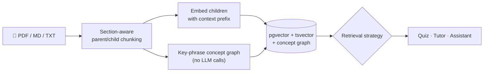

**Indexing is CPU-friendly.** It makes zero LLM calls: a 1,000-word handout indexes in about 3 seconds on a
laptop. About 60-word child chunks are embedded for precise matching ("small-to-big"); the surrounding
180-word parent is what the model reads.

| Strategy | How it works |
|---|---|
| `vector` | Cosine similarity over child-chunk embeddings (pgvector HNSW) |
| `hybrid` ⭐ | Vector + Postgres full-text search, merged with **Reciprocal Rank Fusion** |
| `hyde` | A small model writes a hypothetical answer; that passage is embedded and searched |
| `crag` | **Corrective RAG**: a model grades the passages, then rewrites the query and searches again if too few are relevant |
| `graph` | **GraphRAG** local search: nearest concepts → one hop through the graph → their chunks, fused with hybrid |

### Benchmark

`npm run eval` ingests a sample document and asks 18 questions (keyword, paraphrased and multi-hop) with
every strategy. A hit means the passage containing the answer was retrieved.

| Strategy | Hit@1 | Hit@3 | MRR | Paraphrased (Hit@3) | Avg latency | LLM calls / question |
|---|---|---|---|---|---|---|
| vector | 94% | 100% | 0.96 | 100% | 43 ms | 0 |
| **hybrid** (default) | **100%** | **100%** | **1.00** | 100% | 43 ms | 0 |
| hyde | 89–94% | 94–100% | 0.92–0.97 | 88–100% | ~3.0 s | 1 |
| crag | 100% | 100% | 1.00 | 100% | ~9.5 s | 1–2 |
| graph | 83% | 100% | 0.91 | 100% | 47 ms | 0 |

<sub>Intel i7-1355U laptop, CPU only. HyDE is shown as a range over two runs because its generated passage
varies. **Caveat:** the sample corpus is small (10 passages), so Hit@3 is near its ceiling; Hit@1 and MRR
separate the strategies. On this data plain `hybrid` matches `crag` at about 1/200th of the latency, which is
why it's the default. Run the harness on your own material before choosing.</sub>

## 🔧 Engineering notes

The interesting parts: problems that only show up with real browsers, real networks and real (small) models.

<details>
<summary><b>Exactly-once poll endings</b></summary>

The timer job, the "everyone has answered" check and the teacher's *End now* button can all fire in the same
millisecond. `UPDATE polls SET ended_at = now() WHERE id = $1 AND ended_at IS NULL RETURNING *` guarantees
exactly one caller gets the row and broadcasts results. A partial unique index
(`… ON polls (session_id) WHERE ended_at IS NULL`) makes "one live poll per session" a database
guarantee, safe across server instances.
</details>

<details>
<summary><b>A refresh must not end the poll for everyone</b></summary>

An early version compared *total answers* with *students online*. When a student who had already answered
refreshed, they were briefly offline: 1 answer ≥ 1 online student, and the poll ended before anyone else
answered. The end-to-end suite caught it. Now the poll ends early only when every **online** student is
in the set of respondents.
</details>

<details>
<summary><b>Events lost on connect</b></summary>

The client sends `session:sync` the instant its socket connects, and Socket.IO silently drops events that
arrive before a listener exists. Registering handlers *after* `await socket.join(…)` caused an intermittent
"Connecting…" forever. Handlers are now registered synchronously, and the client retries sync with an
acknowledgement timeout.
</details>

<details>
<summary><b>A whole class behind one IP address</b></summary>

Schools put every student behind one NAT address, so per-IP limits on joining or on the tutor would let
three students lock out the rest of the class. Joining has a classroom-sized limit, and AI endpoints are
limited **per authenticated user**, not per IP.
</details>

<details>
<summary><b>Keeping small models honest</b></summary>

- **Structured outputs:** a JSON schema is passed to Ollama's `format`, then validated with Zod, with one retry
- Answer options are **shuffled in code**, because small models love putting the correct answer first
- Letter prefixes the model invents (`{a} 2 ATP`, `(B) Water`) are stripped
- Questions that **contain their own answer** are rejected
- Insight numbers are computed in SQL; the model only explains them, so it can't invent statistics
</details>

<details>
<summary><b>Tuning for laptop CPUs</b></summary>

On hybrid Intel CPUs (P- and E-cores), Ollama picked **2 threads**. Setting `OLLAMA_NUM_THREAD=6` made
prompt processing about **70% faster**. Prompts are kept short (small-to-big chunks, top 2–3 passages), and
tutor answers stream token by token so a 10-second answer still *feels* responsive.
</details>

<details>
<summary><b>Never running a job twice</b></summary>

A laptop that suspends mid-job loses its BullMQ lock, and the job is handed out again. That would stream
the same tutor answer to a student twice. Jobs check their recorded status before running, and the lock
duration fits CPU-speed model calls.
</details>

## 🗂 Project structure

```text
.
├── apps/
│   ├── web/            React 19 app: landing, dashboard, live console, projector, student view, report
│   ├── server/         Express + Socket.IO API, SQL migrations, auth, poll lifecycle
│   └── ai-worker/      BullMQ worker running every model job, streaming results back
├── packages/
│   ├── rag-core/       Ollama client, chunking, concept graph, 5 retrievers, quiz/tutor/insight/assistant
│   ├── shared/         Typed socket events, Zod schemas, result tallying (used by every app)
│   └── evals/          Retrieval benchmark harness + sample course material
├── e2e/                Playwright tests (real classrooms in real browsers), demo GIF + screenshot capture
├── docs/               Banner, demo GIF, screenshots
├── docker-compose.yml  Postgres (pgvector), Redis, and optional full stack incl. Ollama
├── eslint.config.js    Lint rules for every workspace
├── tsconfig.base.json  Shared strict TypeScript settings
└── package.json        npm workspaces, scripts, Prettier settings
```

About 6,900 lines of strict TypeScript across 7 workspaces.

## ⚙️ Configuration

All settings live in `.env` (copy [`.env.example`](.env.example)).

| Variable | Default | Notes |
|---|---|---|
| `JWT_SECRET` | *(required in production)* | Long random string |
| `AI_ENABLED` | `true` | `false` runs polling only |
| `OLLAMA_URL` | `http://localhost:11434` | |
| `AI_MODEL_SMART` | `qwen2.5:3b` | Quizzes, teaching assistant. With a GPU, try `qwen2.5:7b` or `llama3.1:8b` |
| `AI_MODEL_FAST` | `qwen2.5:1.5b` | Tutor, insights, HyDE, CRAG |
| `AI_MODEL_EMBED` | `all-minilm` | 384-dimension embeddings (matches the schema) |
| `OLLAMA_NUM_THREAD` | `0` (auto) | Set it on laptops; see the engineering notes |
| `RAG_STRATEGY` | `hybrid` | `vector` · `hybrid` · `hyde` · `crag` · `graph` |
| `AI_DAILY_JOBS_PER_TEACHER` | `300` | Protects a shared CPU |
| `AI_WORKER_CONCURRENCY` | `1` | Local models are CPU-bound |
| `CORS_ORIGINS` | `http://localhost:5173` | Comma-separated |
| `VITE_SERVER_URL` | `http://localhost:5000` | Where the web app finds the API |

## 🧪 Testing

```bash
npm test                 # unit tests: tallying, chunking, concept graph, rank fusion, option cleanup
npm run lint && npm run typecheck
npm run e2e              # Playwright, with the app running (npm run dev)
npm run eval             # retrieval benchmark
```

The **end-to-end suite** spins up a teacher and several students in separate browser contexts:

- **`polling.spec.ts`**: signup → session → two students join → answer by click and keyboard → auto-end →
  reveal and score → chat both ways → a student **refreshes mid-question** and resumes → end early → remove
  a student → report numbers → close the session.
- **`ai.spec.ts`**: with **real local models**, upload → indexing → concept map → generate a question →
  launch it → tutor locked during the live question → misconception insight → a streamed tutor answer
  with a citation. About one minute on a laptop CPU.

CI runs lint, typecheck, unit tests and the polling suite against real Postgres and Redis. The AI suite needs
Ollama, so run it locally.

## ☁️ Deployment

ClassPulse has four moving parts: the static web app, the API (it needs long-lived WebSockets), Postgres +
Redis, and Ollama (needs about 4–6 GB of RAM).

| Setup | Web | API + worker | Data | AI |
|---|---|---|---|---|
| **One server** (recommended) | any | `docker compose --profile full up` on an 8 GB VPS | same box | same box |
| **Free, polling only** | Vercel / Netlify | Render, Railway or Fly | Neon (pgvector) + Upstash | `AI_ENABLED=false` |
| **Free, with AI, demo** | Vercel | your machine through a Cloudflare Tunnel | your machine | your machine |

**Web app on Vercel:** set the Root Directory to `apps/web`, the framework to Vite, and add
`VITE_SERVER_URL=https://<your-api>`. The included `apps/web/vercel.json` routes deep links like
`/join/ABC-123` to the app. Then add your Vercel URL to the API's `CORS_ORIGINS`.

## 🗺 Roadmap

Good first issues are marked ✨.

- [ ] ✨ More question types: true/false, numeric, word cloud, ranking
- [ ] ✨ Translations (i18n) for the student view
- [ ] ✨ More sample course packs and benchmark questions in `packages/evals`
- [ ] Spaced-repetition review: re-ask what each student got wrong
- [ ] OCR for scanned PDFs
- [ ] LLM-extracted, typed relations in the concept graph (opt-in, for GPU machines)
- [ ] LMS export (Google Classroom, Moodle) and LTI launch
- [ ] Answer-quality evals for the tutor (faithfulness and citation accuracy), alongside retrieval
- [ ] One-click deploy templates

## 🤝 Contributing

Contributions of every size are welcome: bug reports, docs, translations, new retrieval strategies, UI
polish. Start with [CONTRIBUTING.md](CONTRIBUTING.md). It covers setup, conventions, and how to run the
tests and benchmark before opening a pull request.

If ClassPulse is useful to you, a ⭐ helps other teachers and developers find it.

## 🙏 Acknowledgements

Built on the shoulders of [Ollama](https://ollama.com), [Qwen2.5](https://github.com/QwenLM/Qwen2.5),
[pgvector](https://github.com/pgvector/pgvector), [Socket.IO](https://socket.io), [BullMQ](https://bullmq.io),
[Playwright](https://playwright.dev), [lucide](https://lucide.dev) and [unpdf](https://github.com/unjs/unpdf).

## 📄 License

[MIT](LICENSE): free to use, modify and distribute, including commercially.
